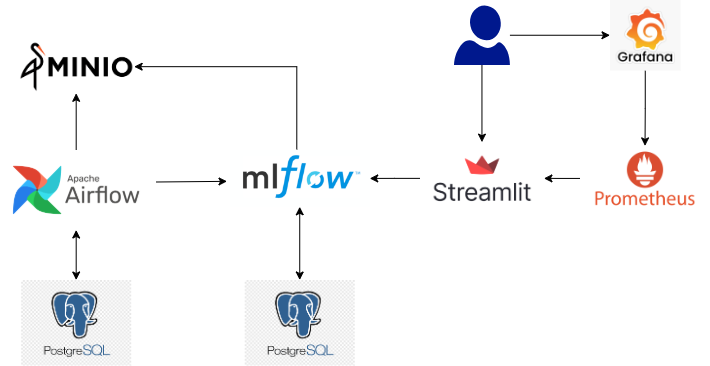

# Solar energy surplus estimator

This is a demo Machine Learning Operation (MLOps) project that aims to help maximizing solar energy self-consumption by predicting the amount produced by solar panels that will not fit in the home battery storage and will be therefore exported to the grid. This energy can then be used to power other home appliances during the day while ensuring that the battery will remain at full capacity at sunset in order to power the house overnight.

# Table of Contents
- [Description](#Description)
- [Architecture](#Architecture)
- [Machine learning pipeline](#Machine-learning-pipeline)
- [Model serving application](#Model-serving-application)
- [Installation and quick start](#Installation-and-quick-start)
- [Monitoring](#Monitoring)
- [Cleanup](#Cleanup)
- [Next Steps](#Next-Steps)
- [Credits](#Credits)

# Description
Let's define *energy surplus* the amount of solar energy that is not instantly consumed by home appliances and then stored in a home storage. When this reaches full capacity, surplus is exported to the grid and paid back according to the energy distributor's fares. As these are usually quite low with respect to imported energy costs, it is much more convenient to consume this energy directly. However, that already stored in the battery should be used to power the house when there is no solar production thus avoid importing from the grid overnight. In an ideal situation, the battery should then be 100% charged at sunset with no energy exported to the grid along the day.

My home storage system allows to download historical data related to solar production and house energy demand in 30-minute time slots. The difference between these values represents the energy surplus produced at a given time of any day. While house energy consumption usually follows a regular pattern across days and seasons, solar production depends on unpredictable factors like weather conditions and air temperature. In order to correctly predict energy surplus in future time slots, we need then to match its historical production with the weather conditions that applied at that time. By summing up the energy surplus predictions from current time to sunset we can have an estimate of the total energy surplus that will be produced during the remaining part of the day.

A machine learning model can be leveraged for this purpose. The training set is then built using historical surplus production data matched with the corresponding weather conditions retrieved by [Open-Meteo](https://open-meteo.com/). By providing the current home storage capacity usage and the weather forecasts from current time to sunset we can predict the energy surplus produced and then the quantity that is expected to overflow the battery capacity. This is what we can consume before sunset not to export it to the grid while keeping the battery at full capacity.

# Architecture
For sake of simplicity, the application runs locally in a `docker compose` container stack that includes these main components:

- **Minio** for S3-like storage
- **Airflow** for DAG-based model training pipeline
- **MlFlow** for model repository and experiment tracking
- **Streamlit** for model serving web UI
- **Prometheus** for metrics collection
- **Grafana** for metrics visualization

()

## Machine learning pipeline
The model training pipeline leverages training data that is automatically uploaded into a Minio bucket during the automated environment setup procedure and it is an obfuscated version of my real home data. The training process includes a hyperparameter optimization step which computes the parameters that provide the best model prediction performance. The resulting model and its parameters are stored in MlFlow with the `production` alias which is leveraged by the model serving application during the inference process to retrive the best model computed so far.
The pipeline can be triggered both manually from the Airflow UI or automatically by the model serving application when no `production` model is found or when a data drift is detected (see the model serving application section for details).

<ins>NOTE</ins>: the training pipeline currently implemented is a basic one and leverages CPUs only, not GPUs. The training process could therefore take several minutes to complete the hyperparameters optimization step. In the meantime, inference is anyway possible if the model being trained is not the first version.

## Model serving application
Model serving is implemented with a Streamlit application accessible by default at `http://localhost:8501`.
In order to get an energy surplus estimate prediction, the user must enter this information:
- day of interest (defaults to current day)
- time of the day (defaults to current local time)
- home battery capacity (defaults to 13.5 Kwh)
- current battery capacity usage (defaults to 0)

By clicking the **Estimate surplus** button, the amount of predicted solar energy surplus is returned, i.e. the energy that will be produced by solar panels till the end of the day and not immediately consumed by home appliances. This value is computed by summing up the energy surplus quantities predicted to be produced in 30-minutes steps from the given time of day until 9:00 pm. These predictions leverage a Machine Learning model trained on the surplus quantities produced in the same month, time of day and weather conditions according to historical data. As this surplus is usually stored in the home battery, the goal is then to predict how much energy will eventually overflow its capacity and be exported to the grid according to current capacity usage. This is the amount of energy that can be used for other non house-related appliances (for example, for charging an electric car) while assuring that the battery will be at full capacity at sunset to power the house during the night.

The **Perform Drift Analysis** button runs a feature drift analysis by considering the amount of samples and the drift threshold set by the user. In a real-world scenario, this analysis is automatically computed when enough data is available in order to trigger an automatic model retraining using an updated dataset to restore its prediction performance. For demo purposes, this functionality can be manually triggered by the user by forcibly adjusting these parameters in order to force a drift detection. The new model training pipeline execution can be followed in the Airflow web page.

## Monitoring
Application monitoring is basically implemented with Prometheus and Grafana by exporting basic metrics from the Streamlit application.
Airflow DAG metrics can be accessed via the Flower web page.
 
No alerting is set up at the moment.

## Installation and quick start
Follow these steps to setup the environment:

- copy `.env.demo` file into `.env` and optionally change environment variables
- run `./start.sh` to finalize environment setup and start the containers (you can have a nice view of them by executing `watch 'docker ps --format "table {{.ID}}\t{{.Names}}\t{{.Status}}\t{{.Ports}}"'` )
- click on the links displayed to open components web pages (credendials in `.env` file when needed). They can be displayed anytime by running `./show-tab-urls.sh`.

Run `docker compose stop` to stop the stack without removing containers and `docker compose up -d` to start it again.

## Cleanup
Run `./cleanup.sh` to:
- take the stack down and remove docker volumes and orphans ( it executes `docker compose down --volumes --remove-orphans` )
- remove installation folders and local data created by containers
- remove custom airflow and model serving application images

## Next Steps
As this is a demo project, plenty of improvements can be added:
- refine model training features
- leverage GPUs during model training process
- provision a cloud environment managed with Terraform
- deploy all workloads in Kubernetes with a GitOps approach
- ... and many others

Any suggestion is appreciated and welcome.

## Credits
This project has been inspired by the great content you can find in the [MLOps Zoomcamp](https://github.com/DataTalksClub/mlops-zoomcamp) repo.
